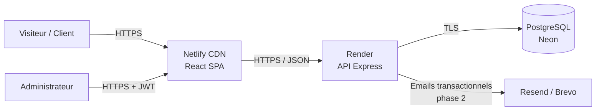
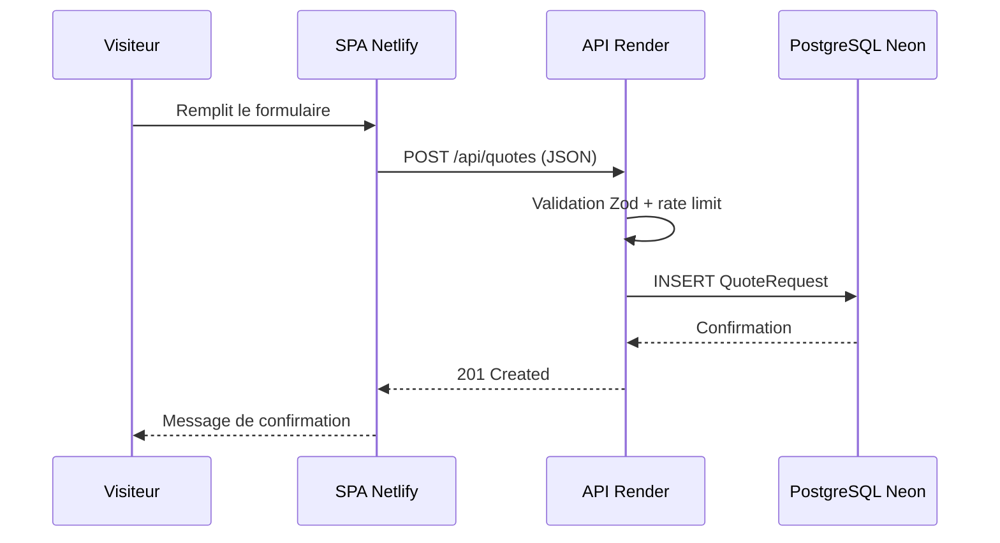
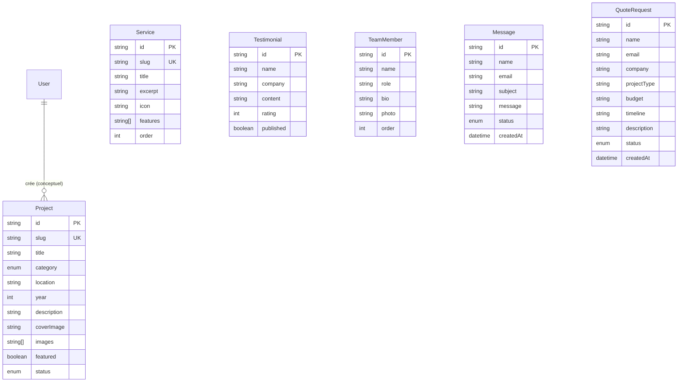

# Plan directeur — Plateforme digitale MM Consulting

> Cabinet d'ingénierie et de conseil en génie civil — Brazzaville, République du Congo
> Version 1.0 — Architecture trois tiers, design premium, déploiement Netlify.

---

## 1. Résumé exécutif

La plateforme est un site vitrine haut de gamme doublé d'un back-office
d'administration. Elle repose sur trois couches totalement indépendantes :

1. **Client** : application React (SPA) compilée en fichiers statiques, hébergée
   sur Netlify. Aucun secret, aucune logique métier sensible côté navigateur.
2. **Serveur** : API REST Node.js/Express, sans état, déployée séparément sur
   Render (ou Railway / Fly.io). Elle porte l'authentification, la validation,
   les règles métier et l'accès aux données.
3. **Base de données** : PostgreSQL managé (Neon ou Supabase), accessible
   uniquement par l'API via une chaîne de connexion chiffrée.

Cette séparation permet de faire évoluer, mettre à l'échelle et redéployer
chaque couche sans impacter les autres. Le frontend peut être mis en cache
mondialement sur le CDN Netlify ; l'API et la base restent privées.

---

## 2. Objectifs et indicateurs

| Objectif | Indicateur cible |
| --- | --- |
| Crédibiliser le cabinet auprès des donneurs d'ordre | Taux de conversion visiteur → demande de devis |
| Générer des prospects qualifiés | Nombre de demandes de devis / mois |
| Présenter les réalisations | Temps passé sur la page Réalisations |
| Rassurer (équipe, méthode, certifications) | Taux de rebond < 45 % |
| Performance | Lighthouse ≥ 95 (Performance, SEO, Accessibilité) |
| Fiabilité | Disponibilité API ≥ 99,5 % |

Parcours principal : **Accueil → Services → Réalisations → Demande de devis**.

---

## 3. Architecture trois tiers



### Principes d'architecture

- **API sans état** : le jeton JWT porte la session, aucun stockage serveur.
- **Séparation stricte des secrets** : `DATABASE_URL` et `JWT_SECRET` vivent
  uniquement dans les variables d'environnement du serveur.
- **CORS explicite** : seuls les domaines Netlify déclarés peuvent appeler l'API.
- **Validation en profondeur** : Zod valide chaque payload avant Prisma.
- **Résilience du site public** : les pages de contenu utilisent un jeu de
  données de secours embarqué si l'API est momentanément indisponible.
- **Déploiements indépendants** : Netlify (client), Render (API), Neon (données).

### Flux d'une demande de devis



---

## 4. Stack technique

| Couche | Choix | Justification |
| --- | --- | --- |
| UI | React 19 + TypeScript | Écosystème mature, typage strict |
| Build | Vite 6 | Démarrage instantané, build optimisé |
| Styles | Tailwind CSS 4 | Design system cohérent, CSS minimal |
| Animations | Framer Motion | Micro-interactions fluides, accessibles |
| Icônes | Lucide React | Cohérence visuelle, poids maîtrisé |
| Routage | React Router 6 | Routes publiques + back-office protégé |
| API | Node.js 20+ / Express 4 | Simplicité, stabilité, hébergement universel |
| ORM | Prisma 6 | Schéma typé, migrations versionnées |
| Base | PostgreSQL 16 | Relationnel robuste, hébergement managé |
| Validation | Zod | Schémas partagés côté serveur |
| Auth | JWT + bcrypt | Standard, compatible API stateless |
| Sécurité HTTP | Helmet, CORS, rate-limit | Défense en profondeur |
| Hébergement client | Netlify, Cloudflare Pages ou GitHub Pages | CDN, déploiement Git |
| Hébergement API | Render ou serveur Node.js | Processus Node permanent, health checks |
| Base managée | Neon | PostgreSQL serverless, branchement Git-like |

---

## 5. Organisation du dépôt

```text
MM-consulting/
├── client/                     # SPA React (Netlify)
│   ├── public/                 # favicon, robots.txt, sitemap, manifest
│   ├── src/
│   │   ├── components/         # layout, ui, sections
│   │   ├── context/            # authentification admin
│   │   ├── data/               # contenu de secours (offline)
│   │   ├── lib/                # client API, types, utils, SEO
│   │   └── pages/              # pages publiques + back-office
│   └── vite.config.ts
├── server/                     # API Express (Render)
│   ├── prisma/                 # schema.prisma + seed.ts
│   └── src/
│       ├── config/             # variables d'environnement
│       ├── lib/                # prisma, jwt, erreurs
│       ├── middleware/         # auth, validation, erreurs
│       ├── routes/             # modules REST
│       └── validators/         # schémas Zod
├── docs/PLAN.md                # ce document
├── .github/workflows/ci.yml    # intégration continue
├── docker-compose.yml          # PostgreSQL local
├── netlify.toml                # build + en-têtes + SPA fallback
├── render.yaml                 # infrastructure API as code
└── package.json                # workspaces npm + scripts racine
```

---

## 6. Modèle de données



### Règles de gestion

- `Project.slug` est unique et stable (bon référencement, liens durables).
- Les projets et services `DRAFT` ne sont visibles que par un administrateur.
- Une demande de devis suit le cycle : `NEW → IN_REVIEW → PROPOSAL_SENT →
  WON / LOST`.
- Un message suit le cycle : `NEW → READ → ARCHIVED`.
- Le mot de passe administrateur est haché (bcrypt, coût 12) et n'est jamais
  renvoyé par l'API.
- Les formulaires publics sont limités en débit pour éviter le spam.

---

## 7. Contrat API REST

Base : `https://<service>.onrender.com/api`

| Méthode | Route | Accès | Description |
| --- | --- | --- | --- |
| GET | `/health` | Public | Santé de l'API et de la base |
| POST | `/auth/login` | Public | Connexion administrateur |
| GET | `/auth/me` | JWT | Profil courant |
| GET | `/projects` | Public | Réalisations publiées (`?featured=true`, `?category=`) |
| GET | `/projects/:slug` | Public | Fiche projet |
| POST | `/projects` | JWT | Création |
| PUT | `/projects/:id` | JWT | Mise à jour partielle |
| DELETE | `/projects/:id` | JWT | Suppression |
| GET | `/services` | Public | Prestations |
| POST/PUT/DELETE | `/services` | JWT | Gestion des prestations |
| GET | `/testimonials` | Public | Témoignages publiés |
| POST/PUT/DELETE | `/testimonials` | JWT | Gestion des témoignages |
| GET | `/team` | Public | Équipe publiée |
| POST/PUT/DELETE | `/team` | JWT | Gestion de l'équipe |
| POST | `/messages` | Public + rate limit | Formulaire de contact |
| GET | `/messages` | JWT | Boîte de réception |
| PATCH | `/messages/:id/status` | JWT | Changement de statut |
| DELETE | `/messages/:id` | JWT | Suppression |
| POST | `/quotes` | Public + rate limit | Demande de devis |
| GET | `/quotes` | JWT | Demandes reçues |
| PATCH | `/quotes/:id/status` | JWT | Changement de statut |
| DELETE | `/quotes/:id` | JWT | Suppression |
| GET | `/stats` | JWT | Compteurs du tableau de bord |

Conventions : réponses JSON, codes HTTP standards (200, 201, 204, 401, 403,
404, 422, 429, 500), erreurs sous la forme
`{ "message": "...", "details": ... }`, authentification
`Authorization: Bearer <token>`.

---

## 8. Design system « Pro Max »

### Direction artistique

Un univers **ingénierie premium** : bleu nuit profond, papier ivoire, accent
laiton/or. Typographie géométrique pour les titres, sans-serif lisible pour le
texte, mono pour les labels techniques. Trame « plan d'architecte » discrète en
arrière-plan, cartes en verre dépoli, photographies pleine largeur.

### Fondations

| Élément | Valeur |
| --- | --- |
| Couleur principale | `#0A1520` (ink) |
| Couleur secondaire | `#111F2D` (ink-soft) |
| Accent | `#DFA62A` (or), `#B9821A` (or foncé) |
| Fond clair | `#F6F3EC` (papier), `#E9E3D5` (sable) |
| Texte secondaire | `#60707E` (acier) |
| Titres | Sora (600–800) |
| Texte | Manrope (400–600) |
| Labels | IBM Plex Mono (500, majuscules, espacement) |
| Grille | 8 points, conteneur 1280 px, gouttières 24–48 px |
| Rayons | 2 px (boutons), 16–24 px (cartes) |
| Ombres | Douces, teintées bleu nuit |

### Composants

Boutons (primaire, secondaire, contour, fantôme), badges, cartes projet,
cartes service, cartes témoignage, champs de formulaire accessibles, en-têtes de
section, compteurs animés, accordéon FAQ, navigation sticky avec menu mobile,
bandeau CTA, footer riche, bouton WhatsApp flottant, tableaux d'administration,
onglets, états vides et squelettes de chargement.

### Mouvement

Apparitions au scroll (fondu + translation 24 px), compteurs progressifs,
survol d'images avec zoom lent, transitions de menu. Toutes les animations
respectent `prefers-reduced-motion`.

### Accessibilité

Contrastes AA, focus visible, navigation clavier complète, labels associés aux
champs, `aria-*` sur les composants interactifs, textes alternatifs, hiérarchie
de titres cohérente, cibles tactiles ≥ 44 px.

---

## 9. Pages publiques

| Route | Contenu |
| --- | --- |
| `/` | Hero, réassurance, services, cabinet, méthode, réalisations, chiffres, témoignages, CTA |
| `/a-propos` | Mission, valeurs, histoire, équipe, certifications |
| `/services` | Six expertises détaillées, méthode, FAQ |
| `/realisations` | Galerie filtrable par catégorie |
| `/realisations/:slug` | Étude de cas : contexte, fiche technique, galerie |
| `/contact` | Coordonnées, horaires, carte, formulaire |
| `/devis` | Formulaire qualifié (type, budget, délai, description) |
| `/admin/login` | Connexion sécurisée |
| `/admin` | Tableau de bord protégé |
| `*` | Page 404 soignée |

### Back-office

- Indicateurs : projets, services, messages non lus, devis en attente.
- Boîte de messages : lecture, changement de statut, suppression.
- Demandes de devis : statut commercial, suppression.
- Réalisations : mise en avant, suppression, accès direct à la fiche publique.
- Session JWT 12 h, stockée côté client, route protégée, déconnexion explicite.

---

## 10. Sécurité

| Mesure | Mise en œuvre |
| --- | --- |
| Hachage des mots de passe | bcrypt (12 rounds) |
| Authentification | JWT signé, expiration 12 h |
| Validation | Zod sur toutes les entrées |
| Injection SQL | Prisma (requêtes paramétrées) |
| En-têtes HTTP | Helmet + en-têtes Netlify |
| CORS | Liste blanche `CLIENT_ORIGINS` |
| Force brute | Rate limit login : 10 essais / 15 min |
| Spam formulaires | 20 requêtes / 10 min par IP |
| Secrets | Variables d'environnement uniquement |
| Fuite de données | Aucun mot de passe renvoyé, erreurs génériques en production |
| Base | Accès restreint au réseau de l'API, TLS obligatoire |

Recommandations de production : activer la rotation des secrets, ajouter un
CAPTCHA invisible (Turnstile) sur les formulaires, journaliser les accès admin,
sauvegarder la base quotidiennement (rétention 7 à 30 jours), imposer un mot de
passe fort et unique.

---

## 11. Performance, SEO et mesure

- Code splitting par route (chargement différé des pages secondaires).
- Images distantes optimisées (CDN, formats AVIF/WebP, `loading="lazy"`).
- Compression Brotli/Gzip via Netlify et compression API.
- Cache CDN long sur les assets fingerprintés.
- Métadonnées uniques par page (titre, description), URL canonique, Open Graph,
  Twitter cards, `robots.txt`, `sitemap.xml`, image de partage 1200×630, favicon
  PNG et `site.webmanifest`.
- Données structurées : `ProfessionalService`, `WebSite`, `BreadcrumbList`,
  `FAQPage` et `CreativeWork` sur les pages concernées.
- Pages de confiance : mentions légales, politique de confidentialité, carrières
  et plan du site.
- Mesure à configurer : Google Analytics 4 ou Umami (respectueux de la vie
  privée), Search Console, suivi des conversions formulaires.

---

## 12. Environnements et déploiement

### Développement local

```bash
npm install
docker compose up -d
cp server/.env.example server/.env
cp client/.env.example client/.env
npm run db:push && npm run db:seed
npm run dev
```

### 12.1 Base de données — Neon

1. Créer un projet PostgreSQL sur [neon.tech](https://neon.tech).
2. Copier la chaîne `postgresql://...?sslmode=require`.
3. La définir dans Render sous `DATABASE_URL`.
4. Appliquer le schéma : `npx prisma migrate deploy` (ou `db:push` en premier
   déploiement), puis `npm run db:seed`.

### 12.2 API — Render

1. Connecter le dépôt GitHub, Render lit `render.yaml`.
2. Renseigner les variables : `DATABASE_URL`, `CLIENT_ORIGINS`
   (origine HTTPS du client), `JWT_SECRET` (généré) et `ADMIN_PASSWORD`
   (secret de production).
3. Vérifier `https://<service>.onrender.com/api/health`.
4. Noter l'URL de base de l'API pour Netlify.

### 12.3 Client — Netlify

1. Importer le dépôt sur Netlify.
2. Build command : `npm run build:client` — publish : `client/dist`
   (déjà déclarés dans `netlify.toml`).
3. Variable d'environnement : `VITE_API_URL=https://<service>.onrender.com/api`.
4. Déployer, puis mettre à jour `CLIENT_ORIGINS` sur Render avec le domaine
   Netlify exact (et les URL de prévisualisation si nécessaire).
5. Ajouter le domaine personnalisé (`www.mmconsulting.cg`) et le HTTPS
   automatique.

> Netlify n'héberge que le frontend statique : l'API et la base restent sur
> Render et Neon, conformément à l'architecture trois tiers demandée.

Cloudflare Pages et GitHub Pages peuvent aussi héberger les fichiers du client.
Ils ne remplacent pas le serveur Node.js ni PostgreSQL. Les instructions
détaillées et les contrôles téléphone, réseau, performance et indexation sont
dans [`DEPLOYMENT.md`](DEPLOYMENT.md).

---

## 13. Intégration et livraison continues

`GitHub Actions` exécute à chaque push/PR : installation reproductible (`npm ci`),
génération Prisma, vérification TypeScript des deux workspaces, build serveur et
build client. Netlify et Render redéploient automatiquement sur `main` après
validation. Les prévisualisations Netlify permettent de valider chaque branche.

---

## 14. Roadmap

### Phase 0 — Fondations (livrée dans ce dépôt)
Monorepo, API REST complète, schéma PostgreSQL, seed, design system, pages
publiques, formulaires connectés, back-office, CI, configuration de déploiement.

### Phase 1 — Mise en production (1 à 2 semaines)
Achat du domaine, contenus réels (photos, textes validés), coordonnées
définitives, comptes Neon/Render/Netlify, sauvegardes, analytics, tests
utilisateurs, audit Lighthouse et sécurité.

### Phase 2 — Conversion et confiance (1 mois)
Études de cas enrichies (avant/après, chiffres clés), blog technique,
newsletter, témoignages vidéo, formulaire avec pièces jointes
(plans, cahiers des charges), CAPTCHA Turnstile, e-mails transactionnels.

### Phase 3 — Portail client (2 à 3 mois)
Espace client sécurisé, suivi d'avancement de chantier, partage de documents,
validation de livrables, notifications, gestion multi-utilisateurs et rôles
(`ADMIN`, `EDITOR`, `CLIENT`).

### Phase 4 — Outils et évolution (3 à 6 mois)
Tableau de bord analytique des prospects, application mobile de terrain,
signature électronique, API publique pour partenaires et internationalisation
français/anglais.

---

## 15. Budget indicatif (USD / mois)

| Poste | Démarrage | Croissance |
| --- | --- | --- |
| Netlify | 0 (Free) | 19 (Pro) |
| Render API | 0 (Free, veille) | 7–25 |
| Neon PostgreSQL | 0 (Free) | 19–69 |
| Domaine `.cg` ou `.com` | ~2–5 | ~2–5 |
| E-mails transactionnels | 0 | 0–20 |
| Total | **~2–5** | **~47–138** |

Les offres gratuites suffisent pour la validation. Pour un site de production
recevant des prospects, prévoir une API sans mise en veille et des sauvegardes
managées.

---

## 16. Checklist avant mise en production

- [ ] Vérifier les coordonnées et les droits de publication de chaque image.
- [ ] Modifier le mot de passe administrateur et `JWT_SECRET`.
- [ ] Créer les migrations Prisma et exécuter `migrate deploy`.
- [ ] Renseigner `CLIENT_ORIGINS` avec le domaine final uniquement.
- [ ] Vérifier CORS, formulaires et back-office depuis le domaine public.
- [ ] Tester mobile, clavier, lecteur d'écran et `prefers-reduced-motion`.
- [ ] Lancer Lighthouse (≥ 95) et corriger les éventuels écarts.
- [ ] Activer les sauvegardes PostgreSQL et tester une restauration.
- [ ] Configurer Search Console, sitemap et analytics.
- [ ] Mettre en place la supervision (uptime, erreurs API) et les alertes.
- [ ] Compléter et valider les mentions légales et la politique de
  confidentialité (RCCM, NIU, hébergeur, durées de conservation).
- [ ] Documenter la procédure de mise à jour des contenus.

---

## 17. Risques et parades

| Risque | Parade |
| --- | --- |
| API gratuite en veille (Render) | Ping d'uptime ou offre payante |
| Perte de données | Sauvegardes Neon + exports réguliers |
| Spam des formulaires | Rate limit, honeypot/CAPTCHA en phase 2 |
| Dépendance à un hébergeur | Architecture portable (Docker, PostgreSQL standard) |
| Contenu obsolète | Back-office + procédure éditoriale trimestrielle |
| Fuite de jeton | Expiration courte, déconnexion, HTTPS strict |
